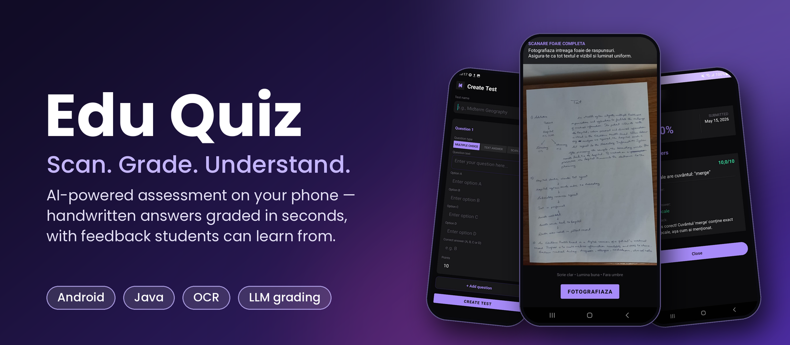
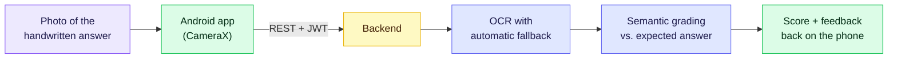
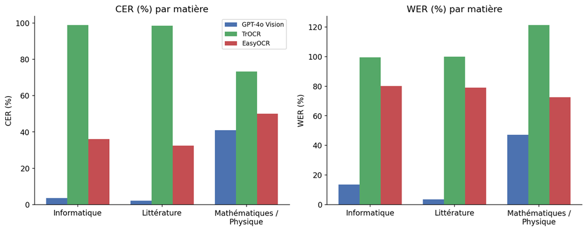
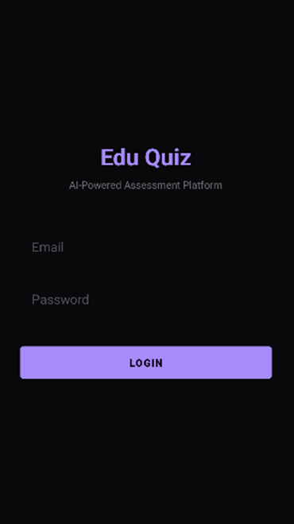
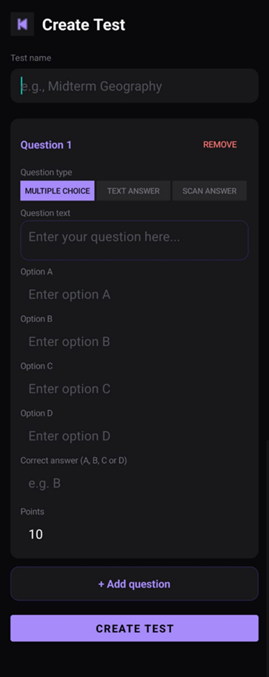
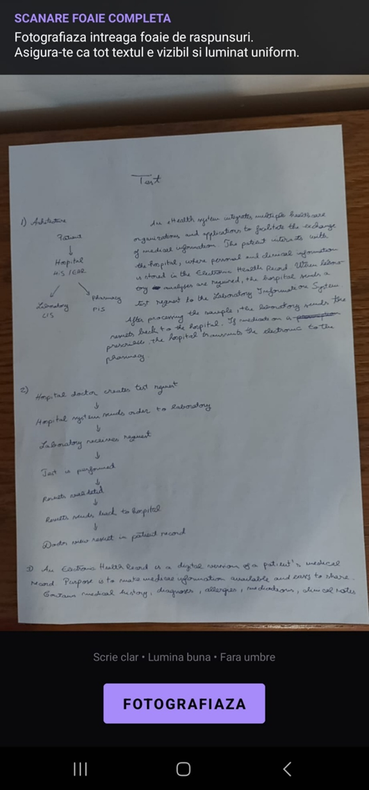
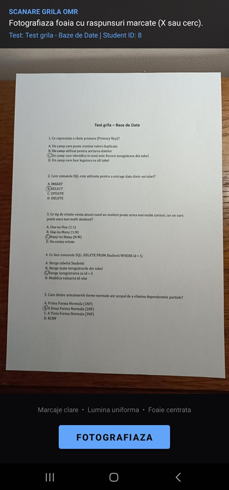
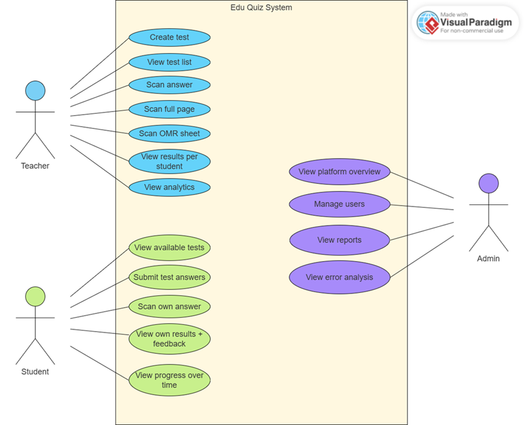

 
 

### Point your phone at a handwritten answer. Get a grade and feedback in seconds.

---

## Why Edu Quiz?

Correcting 30–50 papers by hand takes hours, varies with the grader's fatigue, and leaves students waiting days for feedback.

**Edu Quiz** turns a smartphone into a grading assistant:

- **Teachers** create tests and scan paper answer sheets
- **Students** get instant scores with *explained* feedback
- **Admins** keep an eye on the whole platform

## Features

<table>
<tr>
<td width="33%" valign="top">

### Teacher
- Build tests with **multiple-choice**, **open** and **handwritten-scan** questions
- **Batch scan**: photograph a full answer sheet, every answer is extracted in one shot
- **OMR** scan for multiple-choice sheets
- Analytics dashboard with score distribution and top students
- Question-by-question results per student

</td>
<td width="33%" valign="top">

### Student
- Answer by typing **or by photographing** the handwritten answer
- Instant score with the **correct answer** and **AI-written feedback**
- Progress tracking over time
- Dashboard with average, best test and pending tests

</td>
<td width="33%" valign="top">

### Admin
- Platform overview: users by role, tests, graded submissions
- User management
- Reports: accuracy by question type, per-teacher stats
- AI summary of the **most common mistakes** per test

</td>
</tr>
</table>

## How it works

- **Tolerant to phone-camera reality** — uneven lighting, angled shots, and even the Android UI showing in the frame are handled before recognition.
- **Meaning over wording** — open answers are compared *semantically* with the expected answer, so correct rephrasings aren't penalised.
- **Never stuck** — the recognition and grading steps each have a fallback, so a grade can still be produced if a cloud service is unavailable.

### Recognition accuracy

Measured on a custom corpus of 30 photographed handwritten sheets across three subjects, compared with two other OCR approaches. Lower is better.

| Metric | Result |
|---|---|
| Character error rate — prose answers | **2.1 %** |
| Character error rate — code & short definitions | **3.5 %** |
| Average recognition time per image | **≈ 4.7 s** |

Maths/physics scores are lower, mostly because of notation differences (e.g. `π r²` vs `pi * r^2`), not misreading.

## Screenshots

| Login | Create a test | Scan a handwritten sheet | Scan an OMR sheet |
|:---:|:---:|:---:|:---:|
|  |  |  |  |

## Design

<b>Use cases</b> — three roles, one app

 

<b>Architecture</b> — Android client ⇄ REST ⇄ backend ⇄ database

 

The client talks to the server **only** through REST (JSON, and `multipart/form-data` for images). Every request carries its own JWT in the `Authorization` header — no shared session state.

<b>App structure</b> — Activity–Fragment with role-based dashboards

 

One entry point (`LoginActivity`) routes the user to a dashboard according to their role; each dashboard hosts its sections as fragments behind a `BottomNavigationView`.

| Component | Role |
|---|---|
| `LoginActivity` | Single entry point, routes by role |
| `TeacherDashboardActivity` | Home · Classes · Scan · Analytics · Settings |
| `StudentDashboardActivity` | Home · Tests · Scan · Progress · Settings |
| `AdminDashboardActivity` | Overview · Users · Reports · Settings |
| `TestCreationActivity` | Dynamic test builder |
| `TestSubmissionActivity` | Answer a test (text, multiple choice, scan) |
| `ScanActivity` / `BatchScanActivity` | CameraX capture: single answer / full page |
| `SubmissionDetailActivity` | Per-question answer, score and feedback |
| `RetrofitClient` · `ApiService` · `Constants` | Networking and configuration |

## Tech stack

| | |
|---|---|
| **Language** | Java |
| **UI** | Android Views · Material Components · Activity–Fragment · BottomNavigationView |
| **Networking** | Retrofit2 (async callbacks, multipart image upload) |
| **Camera** | CameraX |
| **Charts** | MPAndroidChart |
| **Auth** | JWT stored in `SharedPreferences`, sent as `Bearer` token; automatic redirect to login on expiry |

## Backend

The server (REST API, OCR and grading pipeline, database) is a separate component. The app expects a JWT-secured REST API for authentication, tests, submissions, dashboards and analytics.